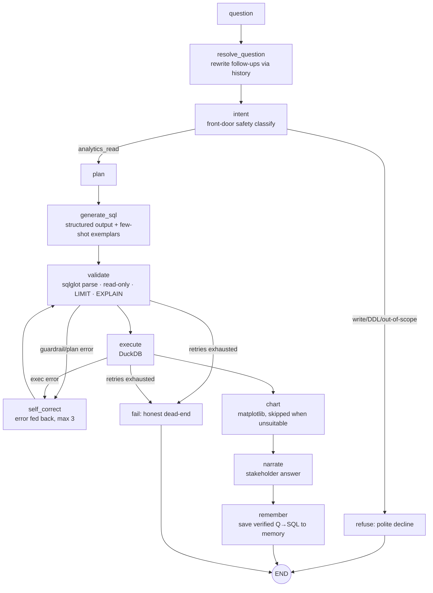
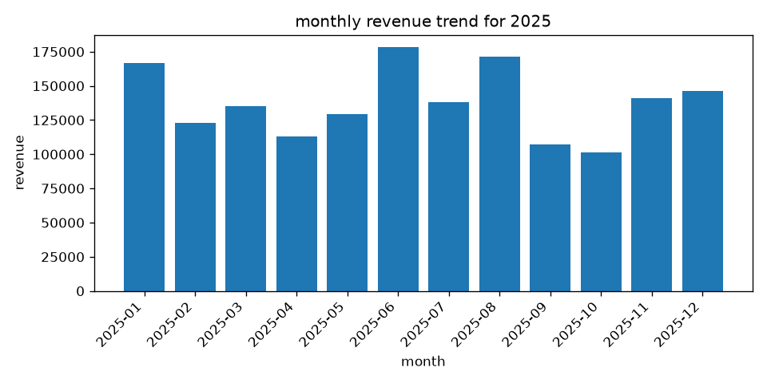

# bi-analyst-agent


A LangGraph BI analyst agent: ask questions in plain English, get validated SQL,
executed results, charts, and a written explanation — with agent memory,
guardrails, and measured accuracy. Built as the standalone research version of
conversational-BI techniques I ship in production.

## Architecture



10-node `StateGraph`, `MemorySaver` checkpointer for multi-turn conversations,
conditional retry edges, `stream_mode="updates"` for live node events.

## Why not just use vanna?

The seed notebook (`notebooks/quickstart.ipynb`) ships vanna 2.x — a hosted
agent framework. This repo is a deliberate from-scratch LangGraph
implementation of the same problem, which makes different trade-offs:

| | vanna 2.x quickstart | this repo |
|---|---|---|
| Agent loop | hidden in framework | explicit `StateGraph` you can read end-to-end |
| Memory | `DemoAgentMemory` (closed demo) | `exemplars.py` — JSONL store, token-ranked few-shot, auto-save on verified success |
| Guardrails | tool-level | sqlglot parse-level: single statement, read-only anywhere in the tree, auto-LIMIT (incl. CTEs), EXPLAIN-before-run |
| Eval | none | 12-question golden set, execution accuracy, per-category breakdown, run history |
| Observability | built-in UI | LangSmith-ready (env-gated) + per-run node trace |
| Tests | none | 27 pytest cases incl. end-to-end graph runs |

## Quickstart

```bash
python -m venv .venv && source .venv/Scripts/activate   # or .venv/bin/activate
pip install -r requirements-dev.txt
cp .env.example .env   # add OPENAI_API_KEY

python -m src.cli "total revenue by country in 2025"
python -m src.cli "and by segment?" --thread demo        # follow-up uses memory
python -m src.cli "monthly revenue trend" --stream       # live node events
python -m src.eval_harness                               # accuracy on golden set
uvicorn src.api:app --reload                             # POST /ask, /ask/stream (SSE), /schema, /health
python -m src.mcp_server                                 # expose tools to any MCP client
langgraph dev                                            # visual graph studio (langgraph.json)
pytest -q                                                # 32 tests
```


```

## Measured results

Eval-driven iteration on the 12-question golden set (`evals/history.jsonl`):

| Iteration | Accuracy | What changed |
|---|---|---|
| Baseline (DDL schema only) | 25% | — |
| + business glossary (status semantics) | 58% | `revenue`/`sold` → `status='completed'` |
| + scoped rules (surrogate keys, buyer-listing, share shape) | 92% | entity-vs-metric output rules |
| + intent rule (named entity, no aggregation word → list) | 100% | `src/semantics.py` |
| + adversarial cases (write/DDL/out-of-scope must refuse), negation, intent gate | **100% on 16** | `intent` node + turn-state reset |

Honest scope notes:

- Ambiguous question phrasing matters — one golden item ("customers who
  bought electronics") flipped between list-vs-aggregate interpretations
  across runs; clarifying eval phrasing is legitimate set hygiene, recorded
  in `evals/history.jsonl`.
- Two real bugs were found BY the eval, not by demos: the self-correction
  loop rewrote guardrail-blocked hostile SQL into benign queries (fixed via
  front-door `intent` refusal), and checkpointer state leaked the previous
  turn's SQL into refused turns (fixed via explicit turn-state reset).
- 16 questions is still a starter set — growing it is the natural next
  contribution.

## Design notes

- **Deterministic pipeline over free ReAct loop** — text-to-SQL wants
  plan→generate→validate→execute→correct, not an open-ended tool loop. The
  graph encodes that; the LLM only fills the nodes.
- **Memory is the accuracy lever** — models imitate verified prior answers
  better than they extrapolate from DDL. Verified pairs are persisted and
  retrieved by question similarity (`data/exemplars.jsonl` ships seeded).
- **Guardrails run before execution** — sqlglot parse (not regex), EXPLAIN
  before run, LIMIT injected even inside CTEs.
- **Honest failure** — after retries the agent reports the last error instead
  of hallucinating a number.

## Observability

Set `LANGSMITH_API_KEY` + `LANGSMITH_TRACING=true` in `.env` for full LangSmith
tracing of every node and LLM call.

## Roadmap

- [x] vanna quickstart seed imported
- [x] LangGraph agent loop (plan → generate → validate → execute → correct → chart → narrate)
- [x] Schema RAG (per-table DDL retrieval)
- [x] Parse-level guardrails (read-only, LIMIT, EXPLAIN)
- [x] Agent memory (exemplar few-shot + auto-save)
- [x] Structured output (`with_structured_output` + Pydantic)
- [x] Conversation memory (`MemorySaver` + follow-up resolution)
- [x] Eval harness (execution accuracy + categories + history)
- [x] Streaming (`--stream`) + pytest suite
- [x] FastAPI service layer (`/ask`, `/ask/stream` SSE, `/schema`, `/health`)
- [x] Distillation data pipeline (`src/gen_training_data.py` — template-verified SQL, LLM paraphrase) + QLoRA notebook (`notebooks/finetune_qlora.ipynb`, Qwen2.5-Coder-1.5B on free Colab T4)
- [ ] Run the Colab fine-tune + student-vs-teacher eval bake-off

## License

MIT. Seed notebook: vanna-ai/vanna (MIT).
